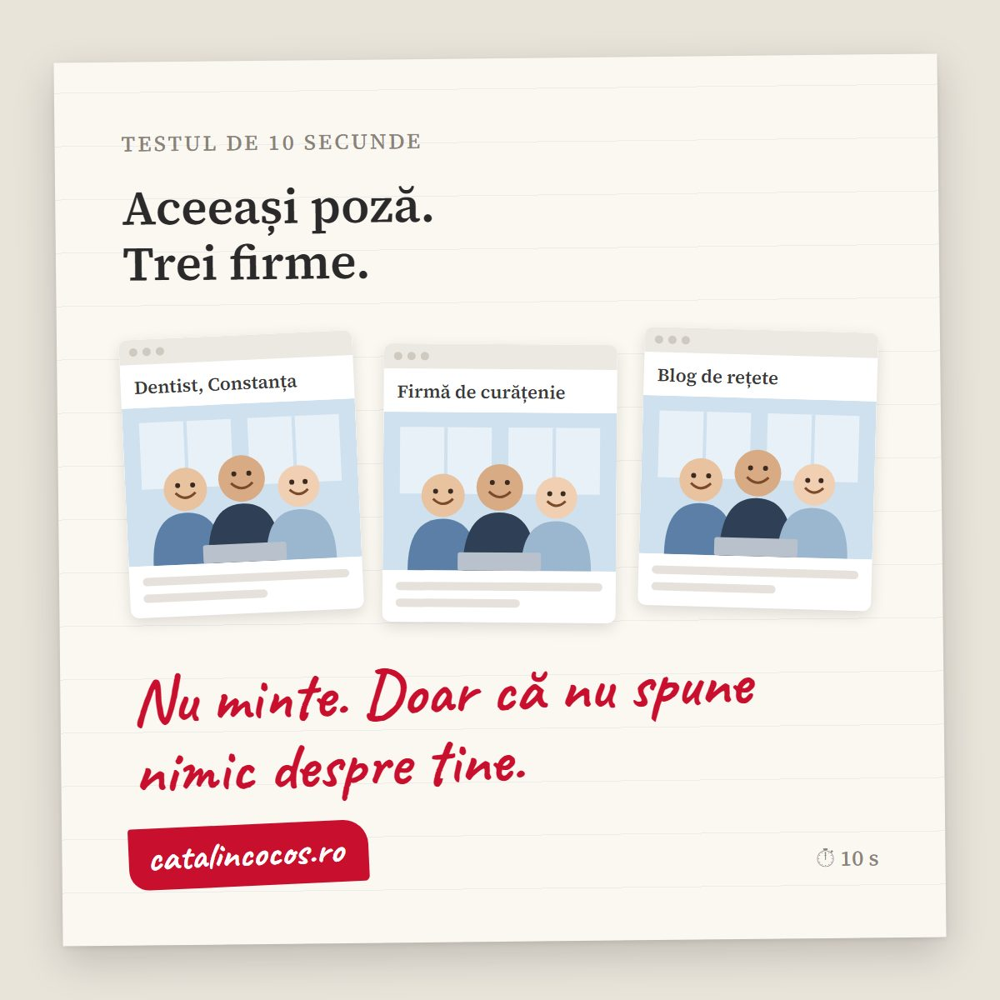

**Pozele pentru site** au două treburi diferite, iar greșeala apare când le încurci. Când ilustrezi o idee (un articol despre SEO, un concept, o stare), o imagine de stoc sau una generată cu AI este suficientă. Când arăți **cine ești, unde lucrezi și ce vinzi**, ai nevoie de fotografii reale: oamenii tăi, locul tău, produsul tău. Oamenii fac diferența imediat. Studiile cu eyetracking ale [Nielsen Norman Group](https://www.nngroup.com/articles/photos-as-web-content/) arată că vizitatorii trec peste pozele decorative de stoc, dar se opresc pe fotografiile cu oameni reali care chiar lucrează la firmă: pe un site testat, utilizatorii au stat cu 10% mai mult pe portretele echipei decât pe biografii, deși biografiile ocupau de peste patru ori mai mult spațiu. Mai jos ai un test de 10 secunde, regula după care aleg eu între stoc, AI și fotografie reală, lista de poze de care are nevoie o firmă mică și cum le pregătești ca să le găsească și Google.

## Testul de 10 secunde: câte firme au poza ta?

Deschide prima pagină a site-ului tău în Chrome. Click dreapta pe poza mare de sus și alege opțiunea de căutare a imaginii cu Google (Google Lens). În dreapta apar rezultatele, iar la „Potriviri exacte" vezi unde mai apare aceeași poză.

Dacă apare doar la tine, ai trecut.

Dacă aceeași echipă zâmbitoare apare și la un dentist din Constanța, la o firmă de curățenie și pe un blog de rețete, ai o problemă. Nu una juridică, dacă ai licența. Una de încredere.

Poza din stoc nu minte. Doar că nu spune nimic despre tine. Clientul vrea să vadă unde ajunge: atelierul, oamenii, masa la care o să stea. Nu o echipă care lucrează, se pare, la toate firmele din țară.

## Ce am învățat la televizor despre imagini

Am lucrat peste 12 ani la burtiera TV, pe știri. Acolo era o regulă pe care n-o încălca nimeni: dacă dai pe post imagini care nu sunt de la locul faptei, scrii pe ecran „imagini de arhivă". Altfel, privitorul crede că vede ce s-a întâmplat azi, acolo. Și când află că nu era așa, nu mai crede nici restul știrii.

O poză de stoc pe pagina „Despre noi" este exact o imagine de arhivă fără etichetă. Omul presupune că aia este echipa ta. Când o regăsește pe alt site (și o poate regăsi oricând, pentru că o poză de stoc se vinde oricui o cumpără), nu mai crede nici textul de lângă ea.

## Regula: imagine generică pentru idei, fotografie reală pentru tine

Pe site-ul meu folosesc toate trei tipurile de imagini. Pe prima pagină, pozele sunt făcute de mine, inclusiv [portofoliul](index.html#portfolio). La articolele de pe blog, multe imagini sunt generate cu AI. Nu este o contradicție. Este o împărțire pe roluri:

- **Imagine de stoc sau AI**: pentru articole, concepte, fundaluri, idei abstracte. Acolo imaginea ilustrează un subiect, nu pretinde că arată ceva real. O imagine AI pentru un articol despre motoarele de căutare nu înșală pe nimeni.
- **Fotografie reală**: pentru tot ce clientul ia drept dovadă. Echipa, sediul, atelierul, produsele, lucrările făcute, clienții (cu acordul lor). Aici o imagine generică nu doar că nu ajută, încurcă.
- **Niciodată AI în locul realității**: o „echipă" generată cu AI, un „sediu" care nu există, un produs „îmbunătățit" până nu mai seamănă cu ce primește clientul. Asta nu mai este ilustrație. Este promisiune falsă, iar clientul o descoperă la prima întâlnire.

<strong>De reținut:</strong> întreabă-te, la fiecare poză, „clientul o să creadă că asta este realitatea mea?". Dacă da, trebuie să fie reală. Dacă nu, poate fi stoc sau AI.

Google nu penalizează imaginile generate cu AI în sine. În [ghidul despre conținutul generat cu AI](https://developers.google.com/search/docs/fundamentals/using-gen-ai-content), îți cere să aduci valoare pentru cititor și recomandă să spui cum a fost creat conținutul, de exemplu prin metadatele imaginii. Pentru magazinele online, regulile sunt mai stricte: imaginile generate cu AI trebuie marcate în metadate.

## Ce spun cifrele despre pozele de pe site

Studiul Nielsen Norman Group este vechi ca prim val (2010), dar a fost revizuit în august 2026 și rămâne cel mai citat pe tema asta. Pe scurt: ochiul trece peste decor și se oprește pe informație.

  

+10%

timp pe portretele reale ale echipei, față de biografii

Nielsen Norman Group

  

316%

mai mult spațiu ocupau biografiile, totuși mai puțin privite

Nielsen Norman Group

  

0,9 vs 4,4

priviri pe poze generice de produs, față de text

Nielsen Norman Group

Ultima cifră spune ceva important: și pozele de produs sunt ignorate, dacă sunt generice. Pe o pagină cu televizoare, unde toate miniaturile arătau la fel, oamenii s-au uitat aproape doar la text. Pe o pagină cu biblioteci fotografiate în detaliu, s-au uitat atent la poze, pentru că îi ajutau să aleagă. O fotografie lucrează doar când îi dă omului o informație pe care altfel n-ar avea-o.

## Ce poze pentru site îți trebuie: lista pentru o firmă mică

Nu-ți trebuie 200 de fotografii. Pentru un site de prezentare, 8-12 poze bune acoperă tot. Asta este lista de la care pornesc când pregătesc o ședință foto pentru un site:

1. **Portretul tău sau al echipei.** Natural, la locul de muncă, nu pe fundal gri de buletin. Pentru pagina „Despre" și pentru prima pagină.
2. **Locul, din exterior.** Fațada, intrarea, firma de deasupra ușii. Îl ajută pe client să te găsească și îi arată că exiști fizic.
3. **Locul, din interior.** Atelierul, cabinetul, sala, biroul. Așa cum este, dar ordonat.
4. **Oamenii la lucru.** Mâini care fac ceva concret. Cea mai convingătoare poză de pe un site este, de obicei, una în care nimeni nu se uită la aparat.
5. **Produsul sau rezultatul.** Lucrarea terminată, preparatul, obiectul, înainte și după. Cu detalii care se văd și la mărire.
6. **Detaliile.** Materialele, uneltele, texturile. Spun „aici se lucrează cu grijă" fără să scrii „calitate".
7. **O poză lată, cu spațiu liber.** Pentru partea de sus a primei pagini, unde vine textul peste imagine. Se gândește de la început, altfel textul acoperă exact fața omului.
8. **Momente cu clienți.** Doar cu acordul lor scris. Pentru firmele de servicii sunt cele mai puternice dovezi.

La ARCUB, de exemplu, am fotografiat [Zilele Bucureștiului](articol.html?slug=arcub-zilele-bucurestiului-2026): oameni reali, străzi reale, momente care nu se pot comanda dintr-o bancă de imagini. Aceeași logică merge la o cofetărie din Timișoara sau la un service auto din Iași. Nimeni nu are prăjiturile tale sau mecanicul tău în stoc.

## Cum pregătești pozele ca să le găsească și Google

O fotografie bună, urcată prost, se pierde. Google are un [ghid oficial pentru imagini](https://developers.google.com/search/docs/appearance/google-images), iar regulile de bază sunt simple:

- **Nume de fișier descriptiv.** `atelier-tamplarie-cluj.jpg`, nu `IMG_00023.jpg`. Fără diacritice și fără spații.
- **Text alternativ (alt text) care descrie poza.** Google îl numește cel mai important atribut al imaginii. Descrie ce se vede, nu înșira cuvinte cheie: „Tâmplar care montează o ușă de stejar în atelierul din Cluj".
- **Poza lângă textul despre ea.** Fotografia atelierului pe pagina despre atelier, nu în galeria generală.
- **Claritate.** Google spune direct că pozele clare atrag mai mult decât cele neclare, inclusiv în miniaturile din rezultate.
- **Dimensiune potrivită.** Pe site-ul meu, pozele se urcă la maxim 1920 de pixeli lățime și primesc automat și varianta WebP, mai ușoară. O poză de 8 MB direct din aparat încetinește pagina, iar o pagină lentă pierde oameni înainte să vadă poza.

Dacă vrei să vezi cum se leagă imaginile de restul site-ului, am scris despre [textele care trec testul burtierei](articol.html?slug=texte-pentru-site) și despre cele [7 greșeli care îți sabotează vizibilitatea online](articol.html?slug=ghidul-complet-vizibilitate-online-romania-2026), printre care și poza de stoc pusă în locul echipei.

## Ai dubii? Bine. Uite răspunsurile.

### Am voie să folosesc poze de pe internet pe site-ul firmei?

Doar dacă ai licență pentru ele sau sunt publicate sub o licență care permite uz comercial. O poză găsită pe Google nu este gratuită doar pentru că se poate descărca. La pozele cu oameni, licența comercială trebuie să includă și acordul persoanelor fotografiate.

### Pozele de stoc strică SEO-ul?

Nu direct. Google nu te penalizează pentru o poză de stoc cu licență. Problema este la oameni: o imagine pe care au văzut-o deja pe alte site-uri nu le spune nimic despre tine, așa că trec peste ea și, de multe ori, peste pagină.

### Pot folosi imagini generate cu AI pe site?

Da, pentru ilustrații: articole, concepte, fundaluri. Nu pentru a înlocui ce clientul ia drept realitate: echipa, sediul, produsele, lucrările. Acolo o imagine AI devine o promisiune pe care n-o poți ține.

### Câte poze îmi trebuie pentru un site de prezentare?

Între 8 și 12 fotografii bune ajung pentru majoritatea site-urilor mici: portret, locul pe dinafară și pe dinăuntru, oamenii la lucru, produsul, detaliile și o poză lată pentru prima pagină. Mai bine puține și reale decât multe și generice.

### Merită un fotograf, dacă am un telefon bun?

Telefonul face poze bune când știi ce fotografiezi, de unde vine lumina și ce trebuie să spună fiecare imagine. Un fotograf de brand aduce mai ales planul: ce poze îți trebuie pentru fiecare pagină și cum arată împreună. Dacă ai deja planul, poți începe și cu telefonul.

## Fă testul acum

Click dreapta pe poza de pe prima pagină, caută-o cu Google și uită-te la „Potriviri exacte". Durează 10 secunde și îți spune ce vede un client care te compară cu alți trei.

Dacă rezultatul nu-ți place, pot să te ajut cu tot pachetul: textele care spun cine ești și fotografiile care îl arată. Sunt copywriter și fotograf, așa că le gândesc împreună, din prima. Vezi [ce fac și cum lucrez](index.html#services) și [câteva fotografii din portofoliu](index.html#portfolio).

<a href="index.html#contact" style="display:inline-block;padding:0.9rem 2.5rem;background:#9e7c50;color:#fff;border-radius:6px;text-decoration:none;font-weight:500;font-size:1.05rem">Scrie-mi despre pozele tale &rarr;</a>

