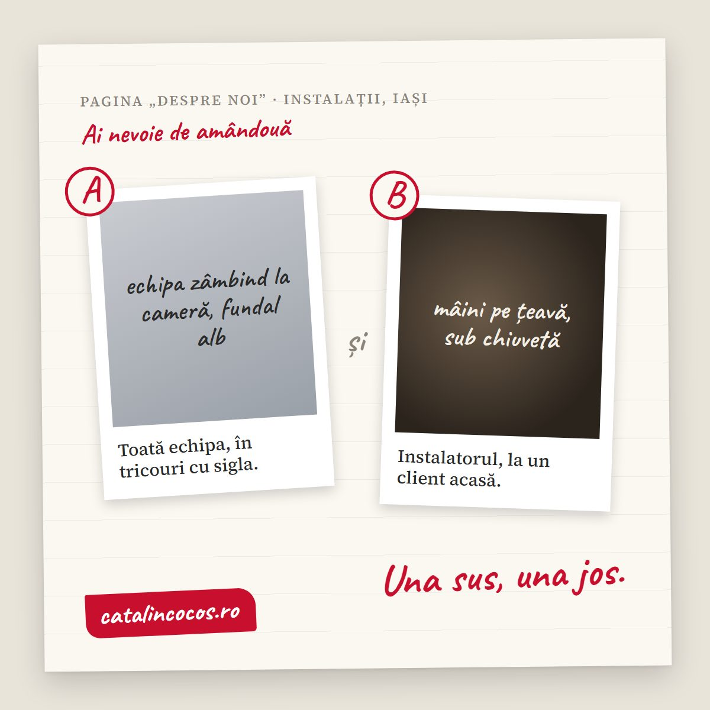

O **ședință foto pentru firmă** iese bine sau prost cu câteva zile înainte să apară fotograful. Ce contează: o listă de cadre făcută pe paginile site-ului (ce poză merge pe prima pagină, ce poză pe „Despre noi", ce poze la servicii), ora aleasă după lumină, locul pregătit fără să fie sterilizat, oamenii anunțați și de acord, în scris, să apară pe site. În ziua ședinței se fotografiază întâi ce depinde de lumină, apoi oamenii, apoi detaliile. După ședință, pozele se aleg pe pagini, se redimensionează pentru web și primesc nume și descrieri pe care le înțelege și Google. Mai jos sunt pașii, în ordinea în care îi fac eu când pregătesc o ședință pentru site-ul unui client, plus greșelile care transformă două ore de fotografii în „avem poze, dar nu avem ce pune".

## De ce iese prost o ședință foto pentru firmă

Aproape niciodată din cauza aparatului. Iese prost pentru că nimeni n-a întrebat înainte „unde merge poza asta?".

Scenariul clasic: fotograful vine, face 300 de cadre frumoase, toată lumea este mulțumită. Peste o lună, cel care face site-ul cere o poză lată pentru partea de sus a primei pagini, cu loc pentru text în stânga. Nu există. Cere o poză cu cineva la lucru pentru pagina de servicii. Sunt doar portrete. Și pe „Despre noi" ajunge, din nou, o poză de stoc.

În [articolul despre pozele pentru site](articol.html?slug=poze-pentru-site) am scris ce poze îi trebuie unei firme mici. Aici este partea dinainte: cum te asiguri că le ai, la sfârșitul unei singure zile.

## Pasul 1: lista de cadre, pagină cu pagină

Iei site-ul (sau schița lui) și treci prin fiecare pagină. Pentru fiecare loc unde vine o imagine, scrii ce trebuie să arate și în ce format.

- **Prima pagină:** o poză lată, orizontală, cu spațiu liber pe o parte, unde vine titlul. Se hotărăște dinainte în ce parte. Altfel, textul acoperă exact fața omului.
- **Despre noi:** echipa, dar și cel puțin o poză în care oamenii lucrează. Portretul spune cine sunteți. Poza la lucru spune ce faceți. Ai nevoie de amândouă.
- **Servicii:** câte o poză pentru fiecare serviciu, cu rezultatul sau cu procesul. Nu aceeași poză de ansamblu repetată.
- **Contact:** intrarea, fațada, firma de deasupra ușii. Clientul o recunoaște când ajunge.
- **Profilul de firmă de pe Google:** exterior, interior, produse. Google cere poze clare, bine luminate, nemodificate puternic, care arată afacerea [așa cum este](https://support.google.com/business/answer/6103862?hl=ro).

Lista asta se face împreună cu cine scrie textele site-ului. Poza și textul de lângă ea trebuie să spună același lucru. Eu le fac pe amândouă, așa că le scriu în același document: titlul paginii, fraza principală, poza de lângă.

<strong>De reținut:</strong> fiecare poză de pe listă are o adresă. Dacă nu știi pe ce pagină merge, n-ai nevoie de ea.

## Pasul 2: lumina și ora

Lumina hotărăște ora, nu agenda.

- **Exteriorul** se fotografiază când soarele nu bate direct în fațadă și nu stă nici exact în spatele clădirii. Te duci cu o zi înainte, la ora la care te gândești să faci poza, și te uiți.
- **Interiorul** arată cel mai bine cu lumină de la fereastră, completată, nu înlocuită. Neoanele din tavan fac pielea verzuie și umbrele sub ochi.
- **Oamenii** se fotografiază lângă fereastră sau în umbră deschisă afară. Soarele de amiază, direct în față, îi face pe toți să mijească ochii.

Dacă firma lucrează cu publicul, ora contează și din alt motiv: o cofetărie la 11 dimineața, cu coadă, nu este locul în care poți muta vitrina ca să intre în cadru.

## Pasul 3: locul, ordonat, dar nu sterilizat

Clientul trebuie să recunoască locul când ajunge acolo. Așa că nu-l transformi în showroom. Doar scoți din cadru ce distrage:

- cabluri, cutii, hârtii lipite pe pereți, sticle de apă pe birouri;
- obiectele cu siglele altor firme (o cană de la un furnizor, un calendar promoțional);
- ecranele pe care se vede ceva ce nu trebuie să ajungă pe internet: date de clienți, prețuri, conversații.

Ce lași: uneltele, materialele, urmele de lucru. Un atelier de tâmplărie din Brașov fără rumeguș pe jos nu mai arată a atelier. Arată a decor.

## Pasul 4: oamenii și acordul lor

Aici se fac cele mai multe greșeli, și nu toate sunt de imagine.

**Hainele.** Culori simple, fără imprimeuri mari și fără siglele altor branduri. Dacă firma are tricouri sau halate cu sigla ei, cu atât mai bine, dar curate și călcate. Spune-le oamenilor cu o zi înainte, nu în dimineața ședinței.

**Cine apare.** Nu toată lumea vrea să fie pe site, și este dreptul lor. Codul civil spune explicit, la [articolul 73](https://avocatcivil.net/ncc-actualizat-comentat/art-73), că orice persoană are dreptul la propria imagine și poate interzice reproducerea înfățișării sale. Faptul că lucrează la tine nu înseamnă că a fost de acord să apară pe internet.

**Acordul, în scris.** O foaie simplă, semnată de fiecare om care apare în poze: ce fotografii, unde vor fi folosite (site, profilul de pe Google, rețele sociale), pentru cât timp. La clienții prinși în cadru, la fel. Și o regulă practică: dacă cineva pleacă din firmă, îi scoți pozele de pe site. Pentru formularea exactă a acordului, întreabă un avocat, mai ales dacă apar copii sau pacienți.

**Cum îi faci să nu stea țepeni.** Nu le ceri să zâmbească. Le dai ceva de făcut: montează, taie, explică, servesc. Cele mai bune poze cu oameni dintr-o ședință de firmă sunt aproape mereu cele în care nimeni nu se uită la aparat.

## Pasul 5: ziua ședinței, în ordine

Ordinea pe care o urmez eu, pentru că lumina nu așteaptă și oamenii obosesc:

1. **Exteriorul**, cât lumina este cea aleasă la pasul 2.
2. **Interiorul gol**, înainte să se umple de oameni și obiecte.
3. **Oamenii la lucru**, cât sunt încă proaspeți.
4. **Portretele și poza de grup**, cu toată lumea strânsă o singură dată, la ora stabilită.
5. **Detaliile și produsele**, la final, pentru că nu depind de nimeni altcineva.

La [Zilele Bucureștiului](articol.html?slug=arcub-zilele-bucurestiului-2026), pentru ARCUB, nu puteam muta nimic: oamenii treceau, lumina se schimba, momentul nu se repeta. O ședință de firmă este invers: aproape totul se poate pregăti. Tocmai de aceea este păcat să o lași pe improvizație.

## Pasul 6: după ședință, pozele ajung pe pagini

O ședință bună se termină cu un folder împărțit pe pagini, nu cu 300 de fișiere numite `DSC_4471.jpg`.

- **Alegerea:** 2-3 variante pentru fiecare loc de pe listă, nu toate cadrele. Cine face site-ul alege mai repede din 30 decât din 300.
- **Dimensiunea:** pentru site, maxim 1920 de pixeli lățime. Pentru profilul de firmă de pe Google: [JPG sau PNG, între 10 KB și 5 MB, ideal 720 x 720 pixeli](https://support.google.com/business/answer/6103862?hl=ro).
- **Numele fișierelor:** descriptive, fără diacritice și fără spații: `echipa-service-auto-iasi.jpg`, nu `IMG_0023.jpg`.
- **Textul alternativ:** o propoziție care descrie ce se vede. Am scris mai pe larg despre asta în [articolul despre poze pentru site](articol.html?slug=poze-pentru-site), la partea despre Google.

Și încă ceva: pozele intră pe site odată cu textele, nu „mai târziu". O pagină cu poză nouă și text vechi arată ca o casă renovată doar pe jumătate. Am scris despre [textele care trec testul burtierei](articol.html?slug=texte-pentru-site), dacă vrei să le schimbi în același timp.

## Ai dubii? Bine. Uite răspunsurile.

### Cât durează o ședință foto pentru o firmă mică?

Pentru un site de prezentare, de obicei o jumătate de zi: exteriorul, interiorul, oamenii la lucru, portretele și detaliile. Mai mult durează pregătirea: lista de cadre, ora, locul și acordurile oamenilor.

### Ce poze îmi trebuie pe pagina „Despre noi"?

Cel puțin două: un portret al echipei (sau al tău) și o poză în care oamenii lucrează. Prima arată cine sunteți. A doua arată ce faceți. Împreună, conving mai mult decât oricare dintre ele singură.

### Am nevoie de acordul angajaților ca să le pun poza pe site?

Da. Orice persoană are dreptul la propria imagine (articolul 73 din Codul civil). Cere un acord scris, care spune ce poze, unde se folosesc și pentru cât timp. Pentru formulare, întreabă un avocat.

### Ce trebuie să pregătesc înainte să vină fotograful?

Lista de cadre pe paginile site-ului, ora potrivită pentru lumină, locul ordonat (fără cabluri, hârtii, sigle străine), hainele oamenilor și acordurile lor scrise. Cu acestea făcute, ședința durează jumătate din cât ar dura fără ele.

### Pot face singur ședința, cu telefonul?

Da, dacă ai lista de cadre și alegi bine lumina. Telefonul nu este problema. Problema este ziua fără plan, după care descoperi că îți lipsește exact poza de care avea nevoie prima pagină.

## Ce faci acum

Deschide site-ul și ia-l pagină cu pagină. La fiecare imagine, întreabă-te: arată ceva real de la noi sau ar putea fi la oricine? Ce iese pe a doua coloană este lista ta de cadre.

Dacă vrei să o facem împreună, textele și fotografiile, gândite din prima unele lângă altele, vezi [ce fac și cum lucrez](index.html#services) și [câteva fotografii din portofoliu](index.html#portfolio).

<a href="index.html#contact" style="display:inline-block;padding:0.9rem 2.5rem;background:#9e7c50;color:#fff;border-radius:6px;text-decoration:none;font-weight:500;font-size:1.05rem">Scrie-mi despre ședința ta foto &rarr;</a>

