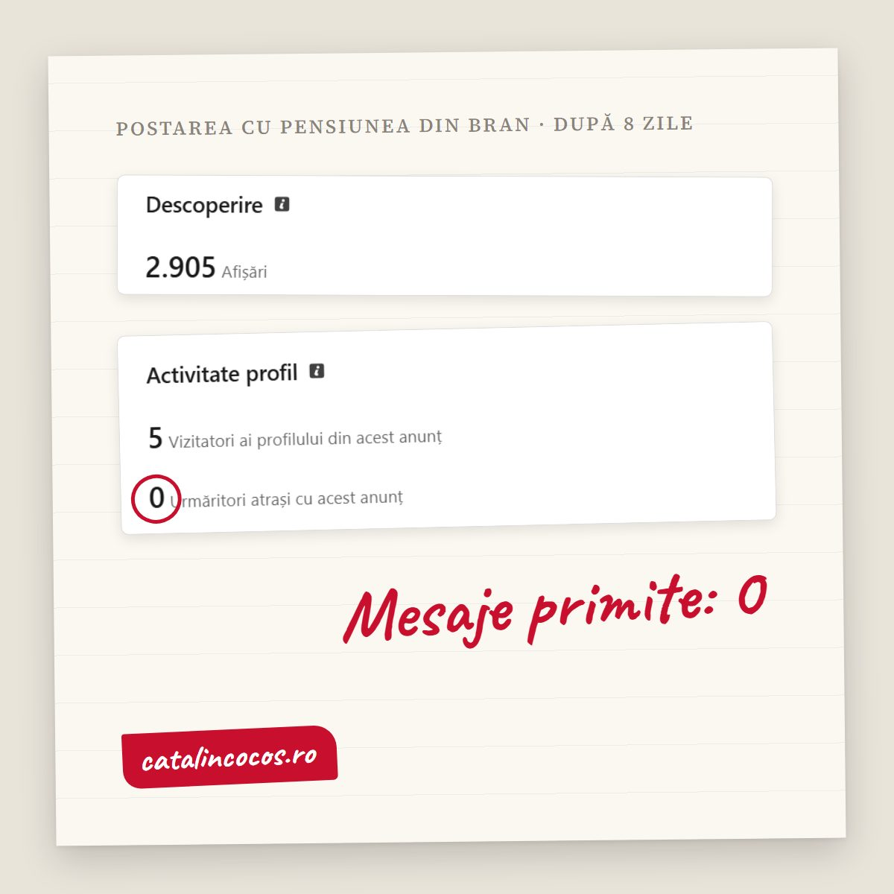

Un **call to action pe site** (îndemnul la acțiune) este fraza sau butonul care îi spune omului ce să facă după ce a citit. Unul bun răspunde, în câteva cuvinte, la trei întrebări: ce fac acum, ce primesc și ce se întâmplă după. „Contact", „Află mai multe" sau „Hai să vorbim" nu răspund la niciuna. Omul care a ajuns la finalul paginii este deja interesat. Dacă nu știe ce urmează, nu sună „mai târziu". Pleacă. Regulile care contează: un singur îndemn principal pe pagină, scris cu verbul acțiunii și cu ce primește omul („Trimite-mi linkul și îți spun până mâine ce aș schimba"), pus după fiecare secțiune care convinge, nu doar în footer, și urmat de un mesaj care spune ce se întâmplă după ce a apăsat. Mai jos sunt exemplele, sursele și un test de 10 secunde pe care îl faci acum, pe site-ul tău.

## 2.905 de oameni, zero mesaje

Acum o săptămână am pus pe LinkedIn două variante pentru prima frază de pe site-ul unei pensiuni din Bran și am întrebat: A sau B? A fost cea mai citită postare a mea de până acum. În opt zile au văzut-o 2.905 oameni. După statisticile LinkedIn, aproximativ unul din zece era patron, director sau fondator de firmă.

Câți mi-au scris? Zero. Cinci au intrat pe profil. Niciunul nu a dat „Urmărește".

Nu a fost vina lor. Le-am cerut să aleagă între A și B. Au ales, în gând, și au mers mai departe. Nu le-am spus ce pot face după. Am scris o postare bună și am uitat exact lucrul pe care îl recomand clienților: finalul.

Pe site se întâmplă la fel, doar că acolo nu vezi niciodată cifra cu „zero". Vezi doar vizitatori. Și te întrebi de ce nu sună telefonul.

## De ce „Contact" nu este un îndemn

„Contact" este numele unei pagini. Nu îi spune omului de ce să meargă acolo, ce primește și ce riscă.

„Află mai multe", „Începe acum" sau „Hai să vorbim" sunt puțin mai bune, pentru că măcar au un verb. Dar au aceeași problemă: omul nu știe ce se întâmplă după click. Îl sună cineva? Primește o ofertă? Trebuie să completeze 12 câmpuri?

Nielsen Norman Group, firma care testează de peste 25 de ani cum folosesc oamenii site-urile, a urmărit exact asta în studiul [„Get Started" Stops Users](https://www.nngroup.com/articles/get-started/). Oamenii apăsau butonul mare „Începe" crezând că vor afla ce face firma. Ajungeau în chestionare și formulare de cont. Un participant care voia doar prețul unui abonament de telefonie a fost purtat printr-un chestionar care se termina cu „sună un consultant". A închis și s-a dus pe site-ul concurenței. Concluzia lor: un link este o promisiune. Dacă nu spune ce urmează, sau spune altceva decât ce se întâmplă, scade încrederea, chiar dacă aduce click-uri.

<strong>De reținut:</strong> butonul trebuie să spună ce se întâmplă după click. Dacă omul trebuie să ghicească, nu mai apasă.

Ca să fiu cinstit până la capăt: pe site-ul meu, butoanele spun „Lucrăm împreună?", „Hai să vorbim" și „Discutăm proiectul tău". Sunt mai calde decât „Contact", dar nu spun ce primește omul. Sunt următoarele pe lista mea.

## Cum arată un call to action care funcționează

Un îndemn bun are trei piese. Nu trebuie să încapă toate pe buton. Butonul poate fi scurt, iar fraza de lângă el spune restul.

1. **Ce faci acum.** Un verb, la persoana a doua: „Trimite", „Sună", „Programează", „Cere". Nu „Detalii", nu „Contact".
2. **Ce primești.** Un lucru concret: o ofertă, un preț, o programare, un răspuns la o întrebare.
3. **Ce urmează și cât durează.** „Îți răspund până mâine la prânz." „Te sunăm în aceeași zi." „Fără obligații." Asta scoate frica de pasul următor.

Câteva exemple, față în față:

| Firma | Îndemnul care nu spune nimic | Îndemnul care spune ce urmează |
|---|---|---|
| Cabinet stomatologic, Constanța | Contactați-ne | Programează o consultație. Te sunăm înapoi în aceeași zi. |
| Service auto, Craiova | Află mai multe | Trimite marca și anul mașinii. Primești prețul reviziei în două ore. |
| Firmă de curățenie, Oradea | Cere ofertă | Spune-ne câți metri pătrați are biroul. Oferta vine până mâine, fără vizită. |
| Copywriter, București | Hai să vorbim | Trimite-mi linkul site-ului. Îți spun într-o frază ce aș schimba prima dată. |

Ultimul rând este al meu. L-am scris ca să nu rămân doar cu teoria.

## Un singur îndemn principal pe pagină

Când la final ai „Sună-ne", „Scrie-ne", „Urmărește-ne pe Facebook", „Abonează-te la newsletter" și „Descarcă broșura", omul nu alege. Amână.

Exemplul clasic este studiul cu dulcețuri al lui [Iyengar și Lepper, din 2000](https://doi.org/10.1037/0022-3514.79.6.995): la un stand cu 24 de sortimente s-au oprit mai mulți oameni, dar au cumpărat aproximativ 3% dintre cei care au gustat. La standul cu 6 sortimente au cumpărat aproximativ 30%. Ca fost jurnalist, trebuie să adaug și restul poveștii: o [meta-analiză din 2010](https://ideas.repec.org/a/oup/jconrs/v37y2010i3p409-425.html), pe 50 de experimente, a găsit că efectul „prea multe opțiuni" apare doar în anumite condiții și, în medie, este aproape zero. Deci nu există o lege care spune că trei butoane îți omoară vânzările.

Regula practică rămâne, dar din alt motiv: pe fiecare pagină **tu** trebuie să știi ce vrei să facă omul. Dacă nu poți spune într-o propoziție, nici el nu poate. Alege un îndemn principal (pe care îl faci vizibil, cu buton) și, dacă vrei, unul secundar, mai discret, pentru cine nu este încă pregătit („Vezi portofoliul", „Citește cum lucrez").

## Unde îl pui pe pagină

Nu doar la final, și sigur nu doar în footer, scris mic, lângă adresa de e-mail.

- **După fiecare secțiune care convinge.** Omul se hotărăște în momente diferite: unul după prima frază, altul după prețuri, altul după a treia recenzie. Îndemnul trebuie să fie acolo când se hotărăște, nu trei ecrane mai jos.
- **La final, obligatoriu.** Cine a citit tot este cel mai interesat om de pe pagină. Nu-l lăsa să dea de un footer gol.
- **Pe telefon, verifică separat.** Pe ecranul mic, butonul din dreapta sus de pe calculator ajunge adesea într-un meniu ascuns. Deschide site-ul pe telefon și caută-l cu degetul mare.

Pentru prima pagină, regula este și mai strictă: omul stă acolo, în medie, sub un minut. Am scris despre asta în articolul despre [texte pentru site și testul burtierei](articol.html?slug=texte-pentru-site): prima frază spune ce faci, imediat sub ea vine dovada, apoi un singur buton.

## După click: mesajul pe care îl uită toată lumea

Îndemnul nu se termină când omul apasă „Trimite". Se termină când află ce urmează.

Până vinerea trecută, după formularul de pe site-ul meu apărea: „Mesajul a fost trimis cu succes." Corect și rece. Acum scrie: „Am primit mesajul. Îți răspund personal, în maximum 24 de ore." Plus un link spre un articol, pentru cine vrea să vadă cum lucrez până atunci.

Diferența pare mică. Dar omul care tocmai ți-a scris este în cel mai fragil moment: s-a expus și nu știe dacă l-a auzit cineva. Un mesaj care spune cine răspunde și când îl ține liniștit. Un mesaj generic îl trimite să mai scrie și altora, „ca să fie".

## Testul de 10 secunde

Fă-l acum, pe telefon, nu pe calculator:

1. Deschide prima pagină a site-ului tău.
2. Derulează până jos, fără să citești.
3. Uită-te la ultimul ecran și răspunde: ce îi spun omului să facă? Ce primește? Când?

Dacă nu găsești răspunsul în 10 secunde, nici clientul nu-l găsește. Și nu te sună să te întrebe.

Dacă vrei să vezi cum se leagă îndemnul de restul textului, am o listă de semne după care recunoști un text care nu-și face treaba în articolul [Textul de pe site-ul tău vinde sau doar ocupă spațiu?](articol.html?slug=textul-de-pe-site-vinde-sau-ocupa-spatiu). Și dacă vrei un titlu care îl duce pe om până la îndemn, citește [cum scrii un titlu care se citește](articol.html?slug=cum-scrii-un-titlu-care-se-citeste).

## Ai dubii? Bine. Uite răspunsurile.

### Ce este un call to action pe site?

Este fraza sau butonul care îi spune vizitatorului ce să facă mai departe: să sune, să scrie, să programeze, să ceară o ofertă. Unul bun spune ce face omul, ce primește și ce urmează după.

### Câte call to action pun pe o pagină?

Un îndemn principal, repetat după secțiunile care conving, și cel mult unul secundar, mai discret. Dacă ai cinci butoane diferite la final, omul amână decizia.

### Ce scriu pe butonul de contact?

Verbul acțiunii și, dacă încape, ce primește omul: „Cere oferta", „Programează consultația", „Trimite-mi linkul". Restul (cât durează, ce urmează) merge în fraza de lângă buton.

### Unde pun call to action-ul pe site?

După fiecare secțiune care convinge, nu doar la final, și obligatoriu pe ultimul ecran al paginii. Verifică separat pe telefon, unde butoanele ajung des în meniuri ascunse.

### Contează și mesajul de după formular?

Da. Este ultima parte a îndemnului. Spune cine răspunde și când: „Îți răspund personal până mâine la prânz" ține omul liniștit. „Mesajul a fost trimis cu succes" nu spune nimic.

## Ce faci acum

Fă testul de 10 secunde. Dacă la finalul paginii tale scrie „Contact", ai găsit primul lucru de schimbat.

Și, ca să fac ce am scris: trimite-mi linkul site-ului tău și îți spun, într-o frază, ce aș schimba prima dată. Dacă vrei apoi să rescriem textele împreună, vezi [ce fac și cum lucrez](index.html#services) și [câteva lucrări din portofoliu](index.html#portfolio).

<a href="index.html#contact" style="display:inline-block;padding:0.9rem 2.5rem;background:#9e7c50;color:#fff;border-radius:6px;text-decoration:none;font-weight:500;font-size:1.05rem">Trimite-mi linkul site-ului tău &rarr;</a>

Îți răspund personal, în maximum 24 de ore.

