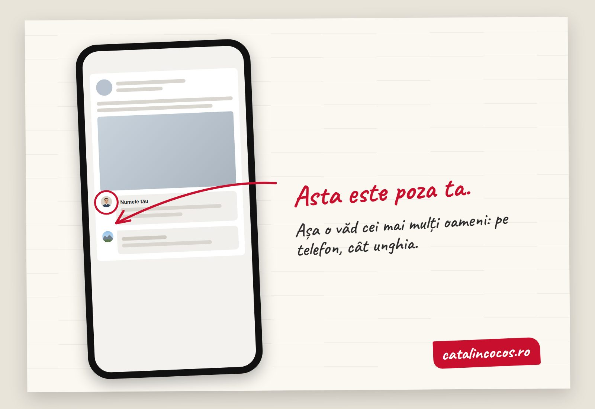

O **poză de profil LinkedIn** bună arată un singur lucru: fața ta, așa cum arăți acum, destul de mare cât să fii recunoscut într-un cerc cât unghia. Concret: capul și umerii umplu cercul, lumina vine din față sau dintr-o parte (cel mai simplu, de la o fereastră), fundalul este simplu, te uiți în aparat, porți ce porți când te întâlnești cu un client. Fără siglă, fără peisaj, fără ochelari de soare, fără umărul altcuiva tăiat pe margine. Contează pentru că oamenii nu se uită la poza ta, o judecă: un studiu de la Princeton a arătat că o zecime de secundă ajunge ca să decizi dacă o față ți se pare de încredere, iar timpul în plus doar te face mai sigur pe ce ai hotărât deja. Mai jos ai un test de 10 secunde, ce spune LinkedIn despre poze, cum fac eu o poză de profil și greșelile pe care le văd cel mai des.

## Testul de 10 secunde: cât de mare este, de fapt, poza ta?

Deschide LinkedIn pe telefon și caută un comentariu de-al tău, sub postarea altcuiva. Uită-te la cercul de lângă nume.

Asta este poza ta de profil, așa cum o văd cei mai mulți oameni. Nu mare, pe pagina ta, unde ai ales-o. Mică, în feed, între două postări, cât unghia degetului mic.

Acum întreabă-te: dacă te-a văzut cineva o singură dată, la o întâlnire sau la un eveniment, te recunoaște în cercul ăla? Sau vede o pată, un peisaj, o siglă?

## Ce spune LinkedIn despre poza de profil

Mai puțin decât ai crede, dar destul de clar. [Regulile oficiale](https://www.linkedin.com/help/linkedin/answer/a1377087) spun că poza te ajută pe tine să fii recunoscut de conexiunile tale și că trebuie să semene cu tine. Poți folosi chiar și o ilustrație sau o caricatură, dacă te reprezintă.

LinkedIn poate șterge poza dacă arată doar:

- o siglă de firmă;
- un emoji, un steag sau un text;
- un peisaj sau un animal;
- o poză din copilărie;
- pe altcineva: imagini de stoc, vedete, personaje.

Cât despre efect, LinkedIn dă propriile cifre: membrii cu poză primesc de până la 21 de ori mai multe vizite pe profil, de 9 ori mai multe cereri de conectare și de 36 de ori mai multe mesaje. Le-au prezentat oameni de la LinkedIn Talent Solutions într-o [prezentare din aprilie 2025](https://www.hancockcollege.edu/pd/documents/CH%20LinkedIn%20Rock%20Your%20Profile%20Deck_-April_2025.pdf). Le iau cu o rezervă: sunt cifrele platformei, fără metodă publicată, și cine își pune poză este, de obicei, și cineva care își folosește contul. Dar direcția nu o contestă nimeni. Un profil fără poză arată a cont abandonat.

  

0,1 s

ajunge ca să judeci o față

Willis și Todorov, Princeton, 2006

  

21x

mai multe vizite pe profil, cu poză

LinkedIn, 2025

  

30%

mai lat pare nasul într-un selfie de aproape

JAMA Facial Plastic Surgery, 2018

## O zecime de secundă

În 2006, doi psihologi de la Princeton, Janine Willis și Alexander Todorov, le-au arătat unor oameni fețe necunoscute timp de 100 de milisecunde, o jumătate de secundă sau o secundă întreagă. Apoi i-au întrebat cât de atrăgătoare, simpatică, competentă, de încredere sau agresivă li se pare fiecare persoană. Judecățile făcute într-o zecime de secundă au fost [foarte apropiate](https://www.psychologicalscience.org/observer/how-many-seconds-to-a-first-impression) de cele făcute fără nicio limită de timp. Timpul în plus nu a schimbat mult părerea. A schimbat doar cât de siguri erau oamenii pe ea ([studiul, pe PubMed](https://pubmed.ncbi.nlm.nih.gov/16866745/)).

Atenție la ce spune studiul și la ce nu spune. Nu spune că oamenii ghicesc corect cine este de încredere. Spune că decid foarte repede și că apoi rămân la decizie. Pentru o poză de profil, asta este exact problema: nu ai a doua șansă. Omul nu dă click să vadă poza mare ca să se convingă. Trece mai departe.

Am lucrat peste 12 ani la burtiera unei televiziuni de știri. Acolo, o frază avea câteva secunde să fie citită până la capăt. Poza de profil are și mai puțin: o zecime de secundă, de câteva ori pe zi, în fața unor oameni care nu te caută, doar dau peste tine.

## Cum fac eu o poză de profil

Sunt fotograf de brand. Pozele de profil sunt cele mai mici fotografii pe care le fac și, de multe ori, cele mai văzute. Regulile mele sunt puține.

**Fața umple cercul.** LinkedIn decupează poza în cerc. Încadrez de la piept în sus, cu puțin aer deasupra capului, și mă gândesc de la început unde va tăia cercul. O poză în care stai întreg, în picioare, în fața unei clădiri, devine în feed un om cât o furnică.

**Lumina vine de la fereastră.** Te așezi cu fața sau cu trei sferturi spre o fereastră mare, ziua, fără soare direct. Este cea mai bună lumină pe care o ai gratis. Neonul din tavan îți face umbre sub ochi. Soarele de amiază, direct în față, te face să mijești.

**Fundalul nu concurează cu tine.** Un perete simplu, o bibliotecă estompată, un colț din biroul tău. Nu tabloul cu cai, nu ușa frigiderului, nu jumătate din bradul de Crăciun.

**Te uiți în aparat.** În feed, ochii sunt singurul detaliu care rămâne. O privire în lateral, „artistică", într-un cerc cât unghia arată a om distrat.

**Nu zâmbești la comandă.** Nu le cer oamenilor să zâmbească. Le cer să-mi povestească ce au de făcut mâine la birou, ce le-a ieșit bine săptămâna asta. Zâmbetul care apare atunci este al lor, nu al fotografului.

**Porți ce porți la client.** Un avocat din Cluj care merge la clienți în costum nu pune o poză în tricou de pe vapor. Un tâmplar din Brașov nu pune o poză în costum. Poza trebuie să se potrivească cu omul pe care clientul îl întâlnește.

## Cu telefonul se poate. Cu selfie, mai greu.

Telefonul nu este problema. Distanța este.

Un selfie se face de la vreo 30 de centimetri, cu brațul întins. De aproape, obiectivul lat al telefonului mărește ce este mai aproape de el, adică nasul. Un studiu publicat în [JAMA Facial Plastic Surgery](https://doi.org/10.1001/jamafacial.2018.0009) a calculat că, într-un selfie de la aproximativ 30 de centimetri, baza nasului pare cu circa 30% mai lată decât într-o poză făcută de la un metru și jumătate. De la un metru și jumătate, distanța obișnuită de portret, diferența dispare.

Deci: roagă pe cineva să te fotografieze de la un metru și jumătate, doi, cu camera principală (nu cu cea frontală), la nivelul ochilor tăi. Dacă telefonul are mod portret, folosește-l, dar verifică marginile: uneori estompează urechile și o parte din păr. Fă 30 de poze, nu trei. Alege una în care arăți ca tine într-o zi bună, nu ca altcineva.

## Greșelile pe care le văd cel mai des

- **Poza decupată de la nuntă.** Se vede un umăr străin, o mână pe după gât, un pahar. Lumea înțelege imediat că n-ai avut altă poză.
- **Poza de acum zece ani.** Omul te recunoaște pe LinkedIn și nu te recunoaște la întâlnire. Prima impresie pe care o lași în persoană este „arată altfel decât în poză". Nu este impresia pe care o vrei.
- **Ochelarii de soare, șapca, poza la volan.** Toate ascund exact ce trebuia arătat: ochii.
- **Sigla firmei în loc de față.** LinkedIn o poate șterge. Iar pe LinkedIn oamenii se conectează cu oameni. Sigla își are locul pe pagina firmei.
- **Filtrele și „îmbunătățirile".** Pielea de porțelan și ochii măriți se văd chiar și în cercul mic. Arată a efort, nu a încredere.
- **Poza generată cu AI.** Ți-o face în două minute, din zece selfie-uri. Dar dacă seamănă cu tine doar pe jumătate, ai ales un portret al unui om pe care clientul nu-l va întâlni niciodată. Pentru imagini care ilustrează idei, AI-ul merge. Am scris despre asta în [articolul despre pozele pentru site](articol.html?slug=poze-pentru-site). Pentru fața ta, nu.

## O singură poză, în toate locurile

Odată ce ai o poză bună, folosește-o peste tot unde te caută cineva: LinkedIn, pagina „Despre" de pe site, profilul firmei de pe Google, WhatsApp-ul de serviciu, semnătura de e-mail. Omul care te-a văzut pe LinkedIn și apoi intră pe site trebuie să recunoască același om.

Și schimb-o când te schimbi tu: altă tunsoare, barbă nouă, zece kilograme în plus sau în minus. O regulă simplă: dacă la ultima întâlnire cineva ți-a spus „nu te-am recunoscut", poza este veche.

Dacă faci pozele pentru toată echipa, ideea este aceeași, doar organizarea este mai mare. Am scris pas cu pas despre [cum pregătești o ședință foto pentru firmă](articol.html?slug=sedinta-foto-pentru-firma): lumina, locul, ordinea și acordul oamenilor.

## Ai dubii? Bine. Uite răspunsurile.

### Ce dimensiune trebuie să aibă poza de profil de pe LinkedIn?

LinkedIn nu publică în ajutorul oficial o dimensiune obligatorie. Încarcă o poză pătrată, clară, de cel puțin câteva sute de pixeli pe latură, cu fața în centru. Platforma o decupează în cerc, așa că lasă loc pe margini.

### Pot pune pe LinkedIn o poză făcută cu telefonul?

Da. Contează distanța, lumina și fundalul, nu aparatul. Roagă pe cineva să te fotografieze de la un metru și jumătate, lângă o fereastră, cu camera principală a telefonului, nu cu cea pentru selfie.

### Este bine să pun sigla firmei în loc de poză?

Nu. Regulile LinkedIn spun că poza de profil trebuie să semene cu tine, iar o poză cu doar sigla firmei poate fi ștearsă. Sigla merge pe pagina de companie.

### Pot folosi o poză de profil generată cu AI?

Regulile cer ca poza să semene cu tine. Dacă o poză făcută cu AI te reprezintă fidel, nu încalcă regula. Problema este practică: dacă omul nu te recunoaște când te întâlnește, poza a lucrat împotriva ta.

### Cât de des ar trebui să-mi schimb poza de profil?

Când arăți altfel decât în poză. Pentru cei mai mulți oameni, asta înseamnă la câțiva ani. Dacă cineva ți-a spus recent că nu te-a recunoscut, schimb-o acum.

## Ce faci acum

Fă testul de mai sus: comentariul tău, pe telefon, cercul de lângă nume. Dacă nu te-ai recunoaște tu însuți dintr-o privire, ai deja răspunsul.

Dacă vrei o poză de profil făcută de un fotograf care o gândește de la început pentru cercul ăla mic, pentru tine sau pentru toată echipa, vezi [ce fac și cum lucrez](index.html#services) și [câteva fotografii din portofoliu](index.html#portfolio).

<a href="index.html#contact" style="display:inline-block;padding:0.9rem 2.5rem;background:#9e7c50;color:#fff;border-radius:6px;text-decoration:none;font-weight:500;font-size:1.05rem">Scrie-mi pentru o poză de profil &rarr;</a>

