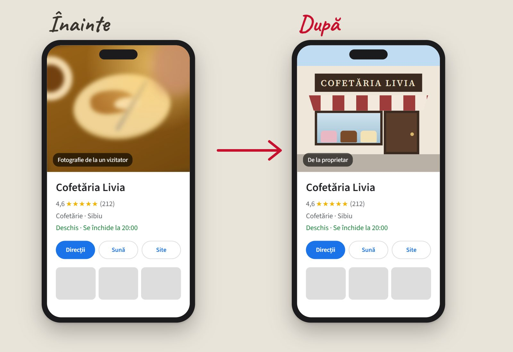

**Pozele pentru Google Business** (în română, Profilul companiei Google, cel care apare pe Google Maps și în căutările locale) trebuie să fie fotografii făcute de tine, la locul firmei, clare și luminate bine: fațada așa cum o vede omul care vine pe stradă, intrarea, interiorul, produsele, oamenii la lucru și o fotografie de copertă care arată cel mai bine ce faci. Google este mai strict aici decât pe site: regulile pentru Maps îți cer să folosești materiale surprinse de tine, la locul respectiv, și spun că pozele de stoc, capturile de ecran și imaginile create de alții nu sunt potrivite. Contează din două motive. Primul: 97% dintre oameni citesc recenziile înainte să aleagă o firmă locală, iar pozele stau chiar lângă ele. Al doilea, pe care îl află mulți abia când este târziu: dacă nu pui tu poze, le pun clienții. Iar dacă fotografia ta de copertă este slabă, Google poate afișa în locul ei poza unui client. Mai jos ai un test de 30 de secunde, regulile oficiale, lista de poze și ce faci cu pozele clienților pe care nu le-ai fi ales.

## Testul de 30 de secunde: ce poză vede omul întâi?

Ia telefonul. Deschide Google Maps și caută firma ta, ca un client care nu te cunoaște. Nu numele firmei, ci ce ar scrie el: „cofetărie Sibiu", „service auto Oradea", „cabinet stomatologic Pitești".

Uită-te la prima poză care apare lângă numele tău. Apoi intră în profil și deschide pozele.

Două întrebări:

- **Cine a făcut prima poză?** Tu sau un client care a trecut pe acolo într-o seară de marți?
- **Ce arată?** Fațada pe care o recunoaște omul când ajunge, sau o farfurie pe jumătate mâncată, sub o lumină galbenă?

Dacă prima poză este a ta și arată ce vrei să arate, ai trecut. Dacă nu, nu ești singur. Și nu este vina clientului. El a pus o poză. Tu nu.

## Ce spune Google despre poze

Regulile sunt în două locuri: [ghidul pentru pozele din Profilul companiei](https://support.google.com/business/answer/6103862?hl=ro) și [regulile pentru materialele de pe Maps](https://support.google.com/contributionpolicy/answer/7411351?hl=en). Pe scurt:

- **Format:** JPG sau PNG, între 10 KB și 5 MB.
- **Mărime:** recomandat 720 x 720 de pixeli, minim 250 x 250. Orice telefon din ultimii zece ani trece de asta. Problema nu este rezoluția, ci ce fotografiezi.
- **Calitate:** clară și luminată bine. Google scrie direct că pozele de calitate slabă pot fi șterse și că o ștergere pentru calitate nu se poate contesta.
- **Realitate:** fără modificări importante și fără filtre în exces. Corecturile mici, de luminozitate sau de rotire, sunt în regulă.
- **Făcute de tine, acolo:** materialele trebuie să fie surprinse de tine, la locul despre care postezi. Stocul, capturile de ecran, colajele și imaginile create de alții nu sunt potrivite.
- **Locul este subiectul:** un selfie, în care omul este subiectul principal, ajută mai puțin decât o poză în care se vede locul.
- **Videoclipuri:** maximum 30 de secunde, maximum 75 MB, rezoluție de minimum 720p.

Regulile nu pomenesc separat imaginile generate cu AI. Nici nu trebuie: o imagine generată nu este surprinsă de tine, la locul respectiv. Pe site, o imagine AI poate ilustra o idee, cum am explicat în articolul despre [poze pentru site](articol.html?slug=poze-pentru-site). Pe Google Maps nu ilustrezi nimic. Arăți unde ajunge omul.

<strong>De reținut:</strong> pe Google Maps, o poză este o promisiune despre un loc. Omul o compară cu ce vede când ajunge. Dacă nu seamănă, nu mai crede nici programul, nici recenziile.

## Dacă nu pui tu poze, le pun clienții

Aici este partea pe care o descoperă cei mai mulți proprietari prea târziu. Profilul tău de pe Google nu îți aparține doar ție. Oricine a trecut pe acolo poate adăuga poze. Și le adaugă: din mers, cu telefonul, la lumina pe care o găsește.

Google spune că fotografia de copertă trebuie să fie cea care îți reprezintă cel mai bine compania. Dar adaugă, în același ghid, că nu garantează că ea va apărea prima. Dacă poza ta de copertă este de calitate slabă, sau dacă alte semnale arată că nu este cea mai bună, Google poate alege în locul ei o fotografie trimisă de un utilizator.

Iar pozele clienților nu le poți șterge tu. Poți doar să [ceri eliminarea](https://support.google.com/business/answer/6130451?hl=en) celor care încalcă regulile: o poză care nu este de la locul tău, una cu date personale, una ofensatoare. O poză doar urâtă nu încalcă nicio regulă. Rămâne.

Ce poți face este să pui poze mai bune decât ea. Asta este, de fapt, toată strategia.

## Ce spun cifrele

  

97%

dintre oameni citesc recenziile firmelor locale

BrightLocal, 2026

  

71%

le citesc pe Google

BrightLocal, 2026

  

36%

au mai multă încredere într-o recenzie cu poză bună

BrightLocal, 2026

Cifrele vin din [sondajul BrightLocal](https://www.brightlocal.com/research/local-consumer-review-survey/) publicat în februarie 2026, făcut pe 1.002 adulți din Statele Unite. Ultima mi se pare cea mai interesantă: pentru mai mult de o treime dintre oameni, o recenzie însoțită de o poză sau un video care arată bine produsul este mai credibilă. Adică pozele clienților tăi lucrează. Pentru tine, dacă arăți bine în ele. Împotriva ta, dacă nu.

Dacă ai căutat cifre despre pozele de pe Google, probabil le-ai văzut pe acestea: „cu 42% mai multe cereri de indicații", „cu 520% mai multe apeluri pentru firmele cu peste 100 de poze". Apar în zeci de articole „actualizate 2026". Am mers la sursă. Vin dintr-un [studiu BrightLocal publicat în 2019](https://www.brightlocal.com/research/google-my-business-insights-study/), cu date din 2017 și 2018, când profilul încă se numea Google My Business. Le-am lăsat deoparte. În presă, o știre de acum opt ani cu data de azi se numește altfel decât știre.

Ce a rămas valabil din studiul ăla este o observație a autorilor: firmele cu multe poze sunt, de obicei, firmele care se ocupă de profil în general. Răspund la recenzii, au programul corect, postează. Nu-ți trebuie 100 de poze. Îți trebuie destule cât să nu decidă clienții în locul tău cum arăți.

## Lista de poze pentru Google Business

Când eram reporter, făceam teren zilnic. Regula era simplă: mergi la fața locului. Nu scrii despre un incendiu din biroul redacției. Google cere același lucru: poza vine de acolo, de unde vine și clientul. Așa că lista mea pornește de la drumul omului, nu de la firmă:

1. **Fațada, din direcția din care vine omul.** De pe trotuarul de vizavi, cum o vede cineva care te caută. Cu firma de deasupra ușii vizibilă. Google spune că poza din exterior îi ajută pe clienți să te recunoască atunci când ajung.
2. **Intrarea.** Mai ales dacă este în curte, la etaj sau pe o stradă lăturalnică. Dacă ești deschis seara, fă o poză și pe întuneric, cu lumina aprinsă.
3. **Parcarea sau reperul.** „Lângă farmacie", „poarta verde". Pentru o clinică sau un service, poza asta economisește un telefon.
4. **Interiorul, așa cum este.** Ordonat, dar nu aranjat ca în catalog. Omul vrea să știe dacă are unde să stea, nu cum ar arăta locul dacă ar fi altul.
5. **Produsele sau lucrările.** Ce vinzi de fapt: prăjiturile din vitrină, mașina după reparație, baia după renovare.
6. **Oamenii la lucru.** Mâini care fac ceva. Lumea vrea să vadă cine o să-i servească.
7. **Echipa.** O poză simplă, cu fețele care se văd. Aceleași reguli ca la [poza de profil de pe LinkedIn](articol.html?slug=poza-de-profil-linkedin): lumină din față, fundal simplu, fără ochelari de soare.
8. **Fotografia de copertă.** Cea mai bună dintre toate, cu subiectul în centru, pentru că Google o decupează diferit pe telefon și pe computer.

Pe lângă ele, sigla, separat, la locul ei. Sigla nu este fotografie de copertă.

Dacă faci toate pozele odată, cu un plan, ieși cu 15-20 de fotografii bune într-o dimineață. Am scris pașii în articolul despre [ședința foto pentru firmă](articol.html?slug=sedinta-foto-pentru-firma). Aceeași ședință îți acoperă și site-ul, și Google.

## Greșelile pe care le văd cel mai des

- **Sigla pusă drept copertă.** Pe telefon devine un pătrat colorat. Nu spune unde ești și nici ce faci.
- **Poza de stoc „ca să fie ceva".** Pe site trece neobservată. Pe Maps este împotriva regulilor și, mai rău, omul nu recunoaște locul când ajunge.
- **Poze cu text mare peste ele.** „Reducere 30%!" scris peste fațadă. Profilul nu este un afiș.
- **O singură poză, din ziua deschiderii.** Cu panglica tăiată și firma veche. Între timp ai schimbat vitrina, culorile, meniul.
- **Pozele făcute pe întuneric, fără lumină.** Google o spune direct: clare și luminate bine. Cea mai simplă lumină este cea de zi, cu ușa deschisă.

## Ai dubii? Bine. Uite răspunsurile.

### Câte poze trebuie să pun pe Google Business?

Nu există un număr cerut de Google. Pentru o firmă mică, 10-15 poze bune acoperă tot: fațada, intrarea, interiorul, produsele, oamenii și o fotografie de copertă. Contează mai mult să fie mai bune decât pozele clienților.

### Pot pune poze de stoc sau generate cu AI pe Google Maps?

Nu. Regulile Google pentru Maps îți cer să folosești materiale surprinse de tine, la locul respectiv, și spun că pozele de stoc și imaginile create de alții nu sunt potrivite. O imagine generată cu AI nu este făcută la locul tău, deci nu are ce căuta acolo.

### Pot șterge pozele puse de clienți?

Nu direct. Poți cere eliminarea lor din profil doar dacă încalcă regulile Google, de exemplu dacă nu sunt de la locul tău sau arată date personale. O poză doar neclară sau urâtă rămâne. Soluția este să pui fotografii mai bune.

### De ce nu apare fotografia mea de copertă prima?

Google spune că nu garantează că fotografia de copertă se afișează prima. Dacă este de calitate slabă sau alte semnale arată că nu te reprezintă cel mai bine, poate alege în locul ei poza unui client. O fotografie de copertă clară, recentă și luminată bine are cele mai mari șanse să rămână.

## Fă testul acum

Deschide Google Maps pe telefon, caută ce ar căuta un client al tău și uită-te la prima poză. Durează 30 de secunde și îți arată ce vede omul înainte să-ți calce pragul.

Dacă nu-ți place ce vezi, pot să fac eu pozele: pentru Google, pentru site și pentru LinkedIn, din aceeași ședință. Sunt fotograf de brand și copywriter, așa că știu și ce poză îți trebuie, și ce scrii lângă ea. Vezi [câteva fotografii din portofoliu](index.html#portfolio) și [ce fac și cum lucrez](index.html#services).

<a href="index.html#contact" style="display:inline-block;padding:0.9rem 2.5rem;background:#9e7c50;color:#fff;border-radius:6px;text-decoration:none;font-weight:500;font-size:1.05rem">Scrie-mi pentru pozele de pe Google &rarr;</a>

